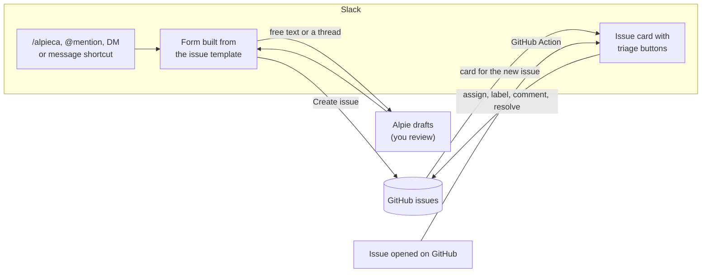

# Alpieca 🦙

**Slack ↔ GitHub, the woolly way.** Alpieca is the Slack app [169Pi](https://github.com/169Pi) uses to turn conversations into well-formed GitHub issues. People describe a bug or an idea in Slack, or point at a thread. [Alpie Seed](https://huggingface.co/169Pi) drafts the issue from the repo's own issue templates, a human reviews it, and the issue lands in GitHub. Issues opened directly on GitHub show up in Slack too, with buttons to triage them.

It's built to be forked. Everything specific to us (the repo, the templates, the command name) is configuration, so you can run the same setup for your own project and Slack workspace.

## What it does

- **Forms built from your issue templates.** `/alpieca` reads `.github/ISSUE_TEMPLATE/*.md` straight from GitHub and turns each template into a Slack form. Edit a template and the form updates within minutes, no redeploy.
- **Drafting with Alpie.** Describe the problem in your own words, @mention Alpieca in a thread, or use *Turn into GitHub issue* on any message. Alpie fills in the template from what was actually said, adds useful context for maintainers, and you review everything before it's filed.
- **Product feedback, with screenshots.** Point Alpieca at a thread, or DM it a screenshot, and it drafts a structured feedback issue in a private product repo. Alpie reads the screenshots, the issue links to the files in Slack, and engineering is tagged. See [Product feedback](#product-feedback).
- **Ask it things.** DM Alpieca or @mention it with a question ("are there any merch ideas filed already?", "how many issues are open?", "how many PRs were merged?", "what do you have access to?"). Alpie answers from the templates, recent issues, exact counts fetched live from GitHub (open and closed issues and PRs, unassigned issues, the last week's activity, open issues by label), and a summary of which repos Alpieca can reach and what it can do in each. Guests only hear about public repos.
- **Issue cards with triage buttons.** Every new issue, whether filed from Slack or opened on GitHub, appears in Slack as a card with **Assign to me**, **Label**, **Comment** and **Mark resolved/Reopen**.
- **Credit for the reporter.** Issues credit whoever raised it in Slack, even when a teammate files it for them, and @mention their GitHub account. See [Who an issue is credited to](#who-an-issue-is-credited-to).



## Using it

| In Slack | What happens |
| --- | --- |
| `/alpieca` | Pick a template, then fill in the form generated from it. |
| `/alpieca merch` | Jump straight to a template by name. |
| `/alpieca <describe the issue>` | Alpie picks the template and drafts the issue for you to review. |
| **More actions → Turn into GitHub issue** on a message | Alpie drafts an issue from that message and its whole thread, and posts the draft in its thread. In a channel Alpieca isn't in, it opens the form instead. |
| `@Alpieca` in a channel or thread, or a DM | Something to raise gets a draft posted in the thread, with **Review and file** and **Pick another template** buttons for anyone there; a question gets an answer in the thread. A bare `@Alpieca` in a thread means "turn this thread into an issue". A DM with just a screenshot or recording counts as something to raise. |
| `/alpieca github <username>` | Link your GitHub account (you're also asked the first time you file). |
| `/alpieca help` | Lists the templates and these options. |

### Drafts in the thread

When you @mention Alpieca about something to raise, or use *Turn into GitHub issue* on a message, it replies in the thread, where everyone can see it. The reply shows Alpie drafting, then the draft's title, tagged for whoever raised it. The rest of the draft stays in the form until someone opens it. Anyone in the thread can click **Review and file** to open the full form, and closing the form loses nothing: the draft stays in the thread, and the button reopens the same draft for up to a day (after that, or after a restart, it drafts again). **Pick another template** redrafts the thread against a template you choose. If Alpie fails, the message offers **Try again**.

When someone files it, the draft message turns into the issue's **card**, so the thread has one message per issue and the same draft can't be filed twice. Issues filed another way post their card where you raised them: the channel, the thread, or your DM. Every card also goes to a team channel if you've configured one.

### Issue cards and triage

Cards show the title, state, labels, reporter and a short preview, plus **View on GitHub**, **🙋 Assign to me**, **🏷️ Label**, **💬 Comment** and **✅ Mark resolved** (or **↩️ Reopen**). Each action happens on GitHub, then the card refreshes from GitHub with a note such as *Marked resolved by @Rahul*. Resolving closes the issue as completed and, when the card is in a thread, says so in the thread. Comments are posted with the commenter's name and GitHub username, and are quoted in the card's thread.

Issues opened directly on GitHub are posted as the same card by the [`alpieca-new-issue`](../.github/workflows/alpieca-new-issue.yml) workflow. Issues filed from Slack carry a hidden `<!-- alpieca -->` marker, so they're never posted twice.

## Product feedback

Alpieca can also file product feedback into a second, usually private, repo (`FEEDBACK_REPO`), such as a product's own code repo. Nothing from Alpieca has to live in that repo: its template is kept here, in [`feedback-templates/`](feedback-templates), and the bot only needs access to its issues.

The feedback template sits next to the main repo's templates in Slack. Picking a template picks the repo, and Alpie picks for you when drafting.

What's different about feedback issues:

- **A template built for triage, mostly clicks.** The *Product Feedback* template asks what engineering needs: product checkboxes (iOS App, Android App, API, Playground, Alpie Chat; tick any), the area, a radio choice of type, what happened, what was expected, steps, who's affected (checkboxes), radio choices of how often and severity, and the device, OS and app version. Required answers must be filled in before filing. Edit [`feedback-templates/product-feedback.md`](feedback-templates/product-feedback.md) on `main` and the form updates within minutes, no redeploy. Turn a field into radio buttons by listing its options: `* **Area (Login, Chat, Settings):**`. Add a product by adding a `- [ ] Name` line.
- **A complete first draft.** From a line like *"the login screen of the app freezes"*, Alpie fills in the area, type and severity, describes what happened, and suggests the expected behaviour and steps to reproduce (including the input that triggers it), for the reporter to check. Titles lead with the product and screen, e.g. *iOS App Chat window: Long prompt overflows the input box and overlaps the greeting*. Layout and overlap problems are rated Minor or Cosmetic, not Major, unless something is broken or the reporter says it's serious. *Additional context* always ends with what's still to confirm with the reporter. It doesn't guess facts only the reporter knows: who's affected, how often, and the app version stay blank unless they said them. Products are ticked only if the reporter names them or a screenshot shows them, so "the app" alone leaves them for the reporter.
- **Screenshots.** Alpie looks at up to four images from the thread and first writes down what they show: the platform and device (an iPhone status bar means iPhone and iOS), the screen, which UI elements go wrong and how (one covering another, cut off, an error message, quoted exactly), and what triggers it. The draft is built from that. The device field and the product ticks are kept consistent: an iPhone ticks the iOS App, and a ticked iOS App fills in iOS.
- **Files stay in Slack.** The form lists the thread's files, all ticked. Ticked files are linked from the issue, and only people in the Slack workspace can open them. Nothing is copied to GitHub. Files in a private channel or DM can only be opened by people in it.
- **The team is tagged.** Issues end with `cc @169Pi/engineering` (`FEEDBACK_GITHUB_MENTION`). GitHub can't assign issues to a team, so people take them with **Assign to me**. Set `FEEDBACK_SLACK_MENTION` to a Slack user group ID to tag the team in the thread too.
- **The card goes back to the thread** it came from, with **View on GitHub**, **Assign to me**, **Comment** and **Mark resolved**.

The main repo works as before, and its issues never link Slack files.

### Setting up a feedback repo

The repo must already exist with **Issues** turned on (*Settings → General → Features*).

**1. A GitHub token for its issues.** Use a separate token, so the bot can't read the repo's code. Ideally create it from a dedicated bot account rather than a person's.
1. Go to [github.com/settings/personal-access-tokens/new](https://github.com/settings/personal-access-tokens/new).
2. **Token name:** `alpieca-feedback`. **Expiration:** your org's maximum, with a reminder to rotate it.
3. **Resource owner:** the organization that owns the repo, e.g. `169Pi`.
4. **Repository access:** *Only select repositories* → the feedback repo.
5. **Permissions → Repository permissions → Issues:** *Read and write*. Leave everything else at *No access*. (*Metadata: Read-only* is added automatically.)
6. **Generate token**, and copy it. If the org requires approval for fine-grained tokens, the token works only after an org owner approves it under *Organization settings → Personal access tokens → Pending requests*.
7. Put it on the server as `FEEDBACK_GITHUB_TOKEN`.

The main `GITHUB_TOKEN` keeps its own access to the main repo, where the feedback template lives. It needs nothing on the feedback repo.

**2. Make the `@169Pi/engineering` mention reach people.** GitHub only notifies people who can see the repo, and only lets an account mention a team it can see. So:
1. The token's account must be a member of the org. Check at `github.com/orgs/169Pi/people`.
2. The team must have access to the feedback repo: in the repo, *Settings → Collaborators and teams → Add teams → engineering*, role *Triage* (lets them label, assign and close) or higher.
3. The team must be *Visible* (*Organization → Teams → engineering → Settings*), not secret.

To check, open any issue in the repo, type `@169Pi/eng` in a comment box, and see that the team is suggested.

**3. A `feedback` label.** In the repo, *Issues → Labels → New label* → `feedback`. Without it GitHub drops the label, and the card says so.

**4. Turn it on.** Set `FEEDBACK_REPO=169Pi/<repo>` and `FEEDBACK_GITHUB_TOKEN`, optionally `FEEDBACK_SLACK_MENTION`, wherever the bot gets its settings (Parameter Store on 169Pi's server, see [Hosting](#hosting)), and restart. Paste the updated [`manifest.yml`](manifest.yml) into the Slack app and **Reinstall to Workspace**, which adds the `files:read` scope Alpieca needs to read screenshots. The startup log lists both repos, with `(private)` after the feedback repo. If it says `(no access: …)` instead, the token can't read the repo: check its repository access, and whether the org still has to approve it.

## How templates become forms

Alpieca works with GitHub's Markdown issue templates as they are. No extra configuration is needed.

| In the template | In Slack |
| --- | --- |
| `title: "[Project]: <…>"` | A **Title** field. The issue is titled `[Project]: <what you typed>`. |
| `### Heading` followed by `*italic guidance*` | A multi-line box, with the guidance shown as a hint. |
| `* **Field:**` bullets under a heading | One single-line input per bullet. |
| `* **Field (A, B, C):**` | Radio buttons for A, B and C (a dropdown if there are more than five). The issue still reads `Field (A, B, C): B`. |
| A heading followed only by `- [ ] A`, `- [ ] B` task items | Checkboxes: tick any number. The issue shows them as a GitHub task list with the picks ticked. |
| `(Optional)` or `(if applicable)` in a heading or bullet | An optional input. Everything else is required. |
| A bullet named like *Repo*, *Link*, *Demo*, *Docs* or *URL* | Must contain an `https://` link. |
| A bullet named like *Author*, *Owner* or *Mastermind* | Pre-filled with the reporter's Slack name. |
| `labels:` and `assignees:` | Applied to the issue. If GitHub drops a label, the card says so. |

The issue is written back in the template's exact layout (same headings, bullets and prefix), so it looks the same as one opened from GitHub's **New issue** page. Unanswered optional fields read `_No response_`.

## Who an issue is credited to

The **reporter** is whoever raised it in Slack: the author of the message used with *Turn into GitHub issue*, the person who started the thread when someone replies with a bare `@Alpieca`, or the person who DMed or @mentioned Alpieca with their own words. When a teammate files it for them, the form says so, and the issue footer reads *Raised from Slack by Priya (@priya) · filed by Vishal (@vishal)*. The card's headline and its *by @…* credit the reporter, using the GitHub account they linked with `/alpieca github <username>`. If they haven't linked one, the card names no GitHub account rather than the bot's.

GitHub itself always shows the **token's owner** as an issue's author, because the bot creates issues with one token. If that token belongs to a person, every issue looks like it was opened by them. Create the tokens from a dedicated bot account (for example `169pi-bot`, a member of the org) instead. The startup log names the account each repo's issues are opened as, e.g. `169Pi/devrel as @169pi-bot`.

## Drafting with Alpie

Alpie is optional. Without `ALPIE_BASE_URL` or `ALPIE_API_KEY`, Alpieca still works, with plain forms.

With Alpie set up, it gets the template's fields and the feedback (free text or a Slack thread). It picks a template if none was chosen, fills in what the feedback supports, and adds an **Additional context** section: who else was involved, constraints that were mentioned, and open questions for a maintainer. **Nothing is filed until a person reviews the draft and clicks *Create issue*.**

The bot doesn't take Alpie's output on trust:

- **Fields:** only fields the template defines are kept. Slack's length limits are enforced, and title prefixes are handled by the bot, not the model.
- **Links:** any link that wasn't in the original conversation is removed, so made-up URLs never reach GitHub. Answers can only link to real issues, the repo, or the conversation.
- **Instructions inside messages:** Slack content is passed to Alpie as data, so instructions written in a message are ignored.
- **Invented reasons:** the prompt tells Alpie not to make up reasons or pitches that nobody gave.
- **Guessed facts:** who's affected, how often and version answers are dropped unless the reporter used those words; product ticks, platform and device unless they named them or sent a screenshot. Dropdown and checkbox answers must be among the options.
- **Emails from screenshots:** email addresses the reporter didn't type (such as a signed-in user's, read off a screenshot) are removed from drafts.
- **Two steps:** with several templates, Alpie first picks one, then drafts against only that template's fields, so answers can't land in the wrong box.
- **Stuck replies:** drafts must match a JSON schema. A reply that gets stuck is cut off and retried.
- **Failures:** if Alpie fails or times out, the reporter falls back to the normal form, and their original text is kept.

**Speed.** Alpieca uses Alpie Seed 9B with reasoning mode off, so most drafts and answers arrive in a few seconds. Reasoning mode (`ALPIE_THINKING=true`) can take 10–20 seconds and isn't usually needed to fill in a template. Alpieca hides the wait in two ways:
- **Drafting ahead:** when an @mention or DM sounds like something to raise, drafting starts immediately and the draft is posted in the thread, before anyone clicks.
- **Live loading animation:** Alpie's output is streamed, so the form and the answer message show the current stage, a 🦙 moving along a progress track, and elapsed seconds. Answers fill in as they're written.

**Other models.** The Alpie client speaks the OpenAI-style `/chat/completions` API, with optional streaming. Point `ALPIE_BASE_URL` and `ALPIE_MODEL` at another compatible endpoint if you prefer. It handles reasoning models that think out loud before `</think>` or send reasoning in a separate field, as well as models that don't. Set `ALPIE_THINKING=true` for a model that always reasons, so the loading animation shows the right stage.

## Access and privacy

Issues land in a **public** repo (and optionally a private feedback repo) under the bot's GitHub token, so access is deliberately narrow:

- **Workspace members only.** People from other organizations (for example in Slack Connect channels) can't file issues, use Alpie, or press triage buttons. Messages from them are ignored.
- **Triage buttons are for full members.** Guests can raise issues but can't assign, label, comment on or resolve them. Set `SLACK_TRIAGE_USERS` to limit triage to specific people.
- **Private repos are for full members.** Guests can't file into a private repo, and Alpie's answers to guests only mention issues in public repos.
- **Files stay in Slack.** Feedback issues only link files that stay ticked in the form, and only workspace members can open those links. Nothing is copied to GitHub, and main-repo issues never link files.
- **The feedback token can't read code.** It only has Issues access to the feedback repo.
- **Private conversations stay private.** An issue drafted from a public channel links back to its source thread. Issues drafted from private channels and DMs don't include a link.
- **Reporters see a warning.** Before filing a draft, the form reminds them the repo is public and that their name and GitHub username will appear on the issue.
- **Content from GitHub is escaped.** Issue titles and bodies can't ping `@channel` or fake links in Slack.

## Fork it for your team

1. **Copy `slack-bot/`, the workflow, and your issue templates** into your repo. Alpieca reads whatever is in `.github/ISSUE_TEMPLATE/`.
2. **Edit [`manifest.yml`](manifest.yml):** change the app name, descriptions, slash command and repo mentions. If you change the command, set `SLACK_COMMAND` to match.
3. **Create the Slack app** from the manifest (below).
4. **Set `GITHUB_REPO`** to your `owner/repo`, and decide whether you want Alpie (or another compatible model) for drafting.
5. **Run it** wherever you can keep one small process running (below).

## Setup

### 1. Slack app
At [api.slack.com/apps](https://api.slack.com/apps), choose **Create New App → From an app manifest**, paste [`manifest.yml`](manifest.yml), and install it to your workspace.
- **Bot token:** *OAuth & Permissions → Bot User OAuth Token* (`xoxb-…`) → `SLACK_BOT_TOKEN`
- **App token:** *Basic Information → App-Level Tokens* → generate one with `connections:write` (`xapp-…`) → `SLACK_APP_TOKEN`

Whenever the manifest's scopes or events change, paste it again and **Reinstall to Workspace**. Invite the bot to channels where you'll use it on threads (`/invite @Alpieca`).

### 2. GitHub token
Create a [fine-grained personal access token](https://github.com/settings/personal-access-tokens/new), or a GitHub App installation token, limited to your repo:
- **Issues:** Read and write
- **Contents:** Read-only

Issues are opened as the token's owner, so create the token from a dedicated bot account. A personal token makes every issue look like that person opened it (see [Who an issue is credited to](#who-an-issue-is-credited-to)). If the repo belongs to an organization, an org owner may need to approve the token. Until they do, it can read but not write.

### 3. Alpie (optional)
Set `ALPIE_BASE_URL=https://test.169pi.ai/v1` to use the hosted Alpie Seed 9B endpoint, which needs no key. For an endpoint that requires a key, also set `ALPIE_API_KEY`.

### 4. Run it locally
```bash
cp .env.example .env    # fill in the tokens
npm install
npm run dev
```
You should see `Alpieca running (Socket Mode), filing into <owner/repo>`. Try `/alpieca help` in Slack.

### 5. Post GitHub-opened issues to Slack (optional)
In your repo's **Settings → Secrets and variables → Actions**, add:
- **Secret `SLACK_BOT_TOKEN`:** the bot's `xoxb-…` token, so button clicks reach the running bot.
- **Variable `SLACK_ISSUES_CHANNEL`:** the channel's **ID** (`C…`, from the channel's *About* tab), not its name.

Invite the bot to that channel. Set the bot's `SLACK_NOTIFY_CHANNEL` to the same ID so issues from Slack and from GitHub land in one place.

## Configuration

| Variable | Required | What it does |
| --- | --- | --- |
| `SLACK_BOT_TOKEN` | yes | Bot token (`xoxb-…`). |
| `SLACK_APP_TOKEN` | for Socket Mode | App-level token (`xapp-…`) with `connections:write`. |
| `SLACK_SIGNING_SECRET`, `PORT` | for HTTP mode | Use instead of `SLACK_APP_TOKEN` to receive events over HTTP at `/slack/events`. |
| `GITHUB_TOKEN` | yes | Fine-grained token with Issues read/write and Contents read. |
| `GITHUB_REPO` | | `owner/repo` to file into. Defaults to `169Pi/devrel`. |
| `GITHUB_TEMPLATE_REF` | | Branch to read templates from. Defaults to the default branch. |
| `ALPIE_BASE_URL`, `ALPIE_API_KEY` | | Setting either turns on drafting and answers. The URL defaults to `https://test.169pi.ai/v1`; the key is only sent if set. |
| `ALPIE_MODEL`, `ALPIE_THINKING`, `ALPIE_TIMEOUT_SECONDS` | | Defaults: `alpie_9b`, `false`, `60`. |
| `SLACK_COMMAND` | | Defaults to `/alpieca`. Must match the manifest. |
| `SLACK_NOTIFY_CHANNEL` | | Channel ID that also gets every new issue card. |
| `SLACK_TRIAGE_USERS` | | Comma-separated Slack user IDs allowed to triage. Defaults to all full members. |
| `DATA_DIR` | | Where Slack-to-GitHub username links are stored. Defaults to `~/.alpieca`. Keep it on persistent storage. |
| `TEMPLATE_DIR`, `TEMPLATE_CACHE_SECONDS` | | Read templates from disk instead of GitHub, and how long to cache them. Defaults: GitHub, 300 s. |
| `FEEDBACK_REPO` | | `owner/repo` that product feedback is filed into. See [Product feedback](#product-feedback). |
| `FEEDBACK_GITHUB_TOKEN` | | Token with Issues read/write on `FEEDBACK_REPO` only. Defaults to `GITHUB_TOKEN`. |
| `FEEDBACK_GITHUB_MENTION` | | Who feedback issues notify on GitHub. Defaults to `@169Pi/engineering`. Empty turns it off. |
| `FEEDBACK_SLACK_MENTION` | | Slack user group (`S…`) or user (`U…`) ID to tag on feedback cards. |
| `FEEDBACK_TEMPLATE_PATH`, `FEEDBACK_TEMPLATE_DIR` | | Where feedback templates come from: a folder in the main repo (default `slack-bot/feedback-templates`), or a folder on disk for development. |

## Hosting

Alpieca is one small Node.js process (about 100 MB of RAM). In Socket Mode it only makes **outbound** connections, so it needs **no public URL, inbound ports or load balancer**. Any always-on machine works: a small VM or VPS, a container platform, or a server you already have. Three things matter wherever you run it:

- **Exactly one instance.** Two copies would split Slack's events between them.
- **Persistent `DATA_DIR`.** It holds the Slack-to-GitHub username links.
- **Secrets as environment variables.** Inject them from your platform's secret store, or from a file only the service can read. Never bake them into an image.

**Docker:**
```bash
docker build -t alpieca .
docker run -d --name alpieca --restart unless-stopped --env-file .env -v alpieca-data:/data alpieca
```

**systemd on a Linux server:** see [`deploy/alpieca.service`](deploy/alpieca.service). The setup steps are in its header comment, and secrets go in `/etc/alpieca.env` with mode `600`. View logs with `journalctl -u alpieca -f`. To update, run `git pull && npm ci --omit=dev`, then `systemctl restart alpieca`.

**AWS EC2 with Parameter Store (how 169Pi runs it):** the same systemd unit, but `ExecStart` runs [`deploy/alpieca-start`](deploy/alpieca-start), which loads every parameter under `/alpieca/` as a setting. There is no env file.
- **To add or change a setting,** create or edit `/alpieca/<NAME>` in *Systems Manager → Parameter Store*, in the instance's region. Use **SecureString**, with the same KMS key as the other secrets, for tokens. Then `sudo systemctl restart alpieca`.
- **To update the code,** `sudo -u alpieca git -C /opt/alpieca pull origin main`. Run `npm ci --omit=dev` in `slack-bot/` only if `package-lock.json` changed. Then restart.
- **To list the settings** without their values: `aws ssm get-parameters-by-path --path /alpieca/ --query 'Parameters[].Name' --output text`.

**Checking a deploy:** the last log line on startup says what's live, e.g. `Alpieca running (Socket Mode), filing into 169Pi/devrel as @169pi-bot and 169Pi/app-alpie (private) as @169pi-bot, drafting with alpie_9b`. The `as @…` account is the author GitHub shows on every issue. A repo shown as `(no access: …)` means its token can't read it, so filing there will fail. You can also ask the bot "which model are you?" in Slack.

## Development

```bash
npm test
```

The tests parse the real templates in `../.github/ISSUE_TEMPLATE`. They cover:
- rendering issues back into each template's layout
- Slack Block Kit limits
- Alpie reply parsing and link filtering, using a fake streaming API
- intent detection, the loading animation, and access rules
- the GitHub workflow script, run against a fake Slack API

| Path | What's in it |
| --- | --- |
| `src/app.js` | Slack handlers: commands, shortcuts, mentions, DMs, forms and triage buttons. |
| `src/templates.js` | Parses issue templates, validates answers, and renders issues. |
| `src/modal.js` | Slack forms. |
| `src/issue-card.js` | Issue cards. Has no dependencies, because the GitHub workflow uses it too. |
| `src/alpie.js` | The Alpie client: drafting, answers, streaming, and output checks. |
| `src/progress.js` | The loading animation. |
| `src/access.js` | Who may use the bot, and which channels are public. |
| `src/people.js` | Stored Slack-to-GitHub username links. |
| `src/github.js` | GitHub API calls. |
| `src/repos.js` | The repos Alpieca files into, each with its own templates. |
| `src/media.js` | Files from Slack: picking them out of threads and showing images to Alpie. |
| `feedback-templates/` | Issue templates for the feedback repo, read from here so that repo holds no Alpieca files. |
| `scripts/post-github-issue.js` | Run by the workflow to post GitHub-opened issues to Slack. |

## License

Copyright 2026 169Pi. Alpieca is licensed under the [Apache License 2.0](LICENSE): fork it, adapt it, and run it for your own team. The license applies to the code in this `slack-bot/` folder.
